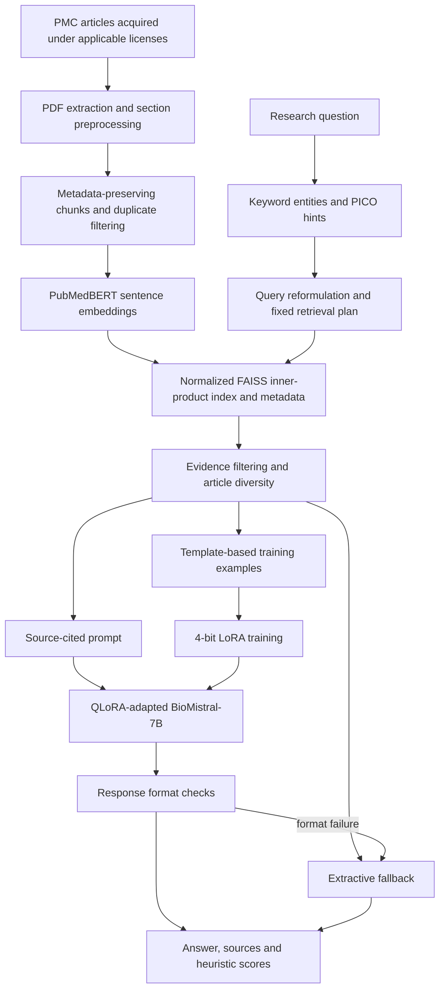

# Biomedical RAG Research Assistant

A Python research prototype that retrieves biomedical literature, builds cited evidence prompts, and generates structured answers with QLoRA-adapted BioMistral-7B. A Streamlit application exposes the retrieval workflow, source metadata, response-format checks, and evaluation exports.

**Research prototype only. This is not a medical diagnosis or treatment system.** Generated claims and citations require full-paper review and expert assessment. Do not enter identifiable patient information.

## Problem and scope

Biomedical literature is difficult to search and synthesize consistently. This project explores a traceable retrieval-augmented generation workflow: retrieve section-level evidence, carry source identifiers into the prompt, and show the retrieved studies alongside the answer. It demonstrates Python pipeline engineering, biomedical embeddings, vector indexing, local LLM integration, parameter-efficient adaptation, and explicit evaluation.

## Verified capabilities

| Component | Implementation |
| --- | --- |
| Document processing | PyMuPDF extraction, Unicode/text cleanup, regex section detection, metadata enrichment |
| Chunking | 500-word section windows with 100-word overlap; minimum-content, numeric-noise and duplicate filters; abstracts handled separately |
| Semantic indexing | `pritamdeka/S-PubMedBert-MS-MARCO` through Sentence Transformers; normalized float32 vectors; FAISS `IndexFlatIP` |
| Query understanding | Keyword biomedical entities and rule-based PICO hints |
| Retrieval planning | User-selected K and a fixed semantic-retrieval strategy |
| Evidence selection | FAISS candidate retrieval, lexical overlap filters and article diversity, with a relaxed fallback |
| Generation | `BioMistral/BioMistral-7B`, 4-bit NF4 loading, PEFT QLoRA adapter, evidence prompts containing title/PMCID/section |
| Validation | Heading and PMCID-pattern checks plus a short unwanted-pattern list; extractive evidence fallback |
| Application | Streamlit query UI, evidence table, stage trace, retrieval evaluation and extractive uploaded-PDF summary |

“Agentic” describes a fixed sequence of named stages implemented in Python. Query analysis and planning are rules, not independently reasoning LLM agents. **The final implementation does not use LangChain orchestration.** Earlier academic experiments are outside this publication copy. There is no learned reranker, calibrated confidence estimate, or clinical factuality validator.

## Architecture



The UI's “reasoning trace” shows stage inputs and outputs; it is not a model reasoning explanation. See [architecture details](docs/ARCHITECTURE.md).

## Technology and repository layout

Python, PyTorch, Hugging Face Transformers, PEFT, bitsandbytes, Sentence Transformers, FAISS, pandas, NumPy, PyMuPDF, Requests, Datasets, Accelerate, and Streamlit.

```text
app.py                         Streamlit entry point
biomedical_rag/                Pipeline modules, UI, workflow helpers and config
data/corpus_manifest.csv       152 identifiers and recorded license metadata
results/historical/            Original retrieval exports and generation metrics
tests/                         Focused synthetic-data regression tests
tools/evaluate_workflow.py     CLI for the UI retrieval/evaluation path
docs/                          Reproduction, architecture, provenance and review notes
workspace/                     Local generated artifacts (ignored; not distributed)
```

## Dataset

The inspected final artifacts contain **152 processed documents, 2,267 chunks and metadata records, and 175 generated instruction examples**. These are local artifact counts, not a claim about a standard benchmark. The balanced selection script targets 19 research articles per year across 2019–2026.

The publication copy includes identifiers and recorded article-license metadata, but no full-text PDFs, extracted article JSON, training text, FAISS indexes, checkpoints or model weights. Recorded licenses include noncommercial and no-derivatives terms. See [data acquisition and reconstruction](docs/DATA.md) and [licensing review](docs/LICENSING.md) before acquiring or reusing material.

## Installation

Run commands from the repository root. Python 3.12 was used for local validation. The generation and training code uses CUDA-oriented 4-bit loading and FP16 training; a compatible NVIDIA GPU and PyTorch/bitsandbytes installation are required for this implementation. The local generation attempt ran out of GPU memory; CPU-only generation is not established.

```powershell
python -m venv .venv
.\.venv\Scripts\Activate.ps1
python -m pip install -r requirements-dev.txt
python -m pip install -e . --no-deps
python -m pytest -q
```

On Linux/macOS, activate with `source .venv/bin/activate`. Install the PyTorch build appropriate to the CUDA environment. Dependencies are direct specifications, not an independently validated environment lock. [Validation notes](docs/VALIDATION.md) record the tested environment and remaining limitations.

## Configuration

All generated artifacts default to `workspace/` beneath the repository. Override this with an absolute `BIOMEDICAL_RAG_WORKSPACE` environment variable. `.env.example` lists supported settings; **the application does not automatically load `.env` files**.

```powershell
$env:BIOMEDICAL_RAG_WORKSPACE = "C:\local-data\biomedical-rag"
$env:NCBI_EMAIL = "your-contact-address"
# Optional: set NCBI_API_KEY and HF_TOKEN locally when needed.
```

`BIOMEDICAL_RAG_EMBED_MODEL` and `BIOMEDICAL_RAG_BASE_MODEL` override model identifiers. Changing the embedding model requires rebuilding the index. The app expects a PEFT adapter compatible with the selected base model. Query logging is disabled by default; setting `BIOMEDICAL_RAG_LOG_QUERIES=1` stores query text locally under `workspace/logs/`.

## Rebuild and run

First acquire license-appropriate articles and create `workspace/pdfs/PMC….pdf` and `workspace/metadata.csv`, as described in [DATA.md](docs/DATA.md). Do not run training against an empty workspace.

```powershell
python -m biomedical_rag.preprocessing_final
python -m biomedical_rag.create_chunks
python -m biomedical_rag.create_faiss_index
python -m biomedical_rag.prepare_qlora_dataset
python -m biomedical_rag.qlora_train
python -m streamlit run app.py
```

The UI can start without the corpus or adapter; answering a question requires both. Uploaded-PDF summarization is extractive and does not add the document to FAISS. An additional baseline CLI, `python -m biomedical_rag.rag_generate`, loads the base model without an adapter. The preserved `test_retrieval` and `test_finetuned_model` modules are interactive smoke scripts, not automated unit tests.

## Fine-tuning methodology

The dataset builder uses 25 base questions and seven templates (seed 42), retrieves evidence, and constructs target answers by extracting overlapping sentences. It requests 175 examples. These are synthetic, template-derived examples, not clinician-authored labels.

Training uses 4-bit NF4 with double quantization; LoRA rank 8, alpha 16, dropout 0.05; attention projections `q_proj`, `k_proj`, `v_proj`, `o_proj`; maximum sequence length 1,024; two epochs; batch size 1; gradient accumulation 4; learning rate 2e-4; FP16; and paged AdamW 8-bit. The causal LM objective covers the formatted instruction, input and response. The script has no held-out validation split, and this copy does not claim a measured fine-tuning improvement.

## Evaluation and saved results

Five fixed queries cover atrial fibrillation/mHealth, oncology enrollment, remote monitoring, trial retention and cardiovascular wearables.

| Historical export | Verified saved result |
| --- | --- |
| UI retrieval at K=3 | Mean Precision@3 = **1.00**; mean implementation NDCG@3 = **1.00** |
| UI retrieval at K=5 | Mean Precision@5 = **0.96**; mean implementation NDCG@5 = **1.00** |
| Standalone raw top-3 retrieval | 15/15 returned chunks pass its keyword relevance rule |
| Standalone generation evaluation | Mean weighted heuristic score = **0.3894** over five responses |

Relevance means at least one expected keyword appears in a chunk or its metadata. NDCG divides DCG by the sorted **retrieved** labels, rather than corpus-wide relevance judgments. Scores of 1.00 therefore do not establish perfect retrieval or clinical relevance. The raw top-K CLI and filtered UI use different retrieval paths and slightly different keyword lists.

The generation score combines heading structure (35%), word overlap with evidence (35%), presence of a PMCID pattern (20%), and answer length (10%). It is not factual accuracy. The UI's separate score combines average retrieval similarity (70%) with response-format score (30%); it is an uncalibrated heuristic.

```powershell
python -m biomedical_rag.evaluate_retrieval
python -m tools.evaluate_workflow --k 3
python -m tools.evaluate_workflow --k 5
python -m biomedical_rag.evaluate_generation_auto
```

New results go to the ignored workspace, leaving historical exports unchanged. Original generation answers contain article-derived text and are withheld; numeric metrics are preserved. See [evaluation details](docs/EVALUATION.md).

## Demo and screenshots

Run the Streamlit entry point to explore the three tabs: research assistant, retrieval evaluation and uploaded-PDF summary. Original screenshots exist in the academic workspace but are excluded because they embed literature excerpts and have not been cleared for redistribution. There is no claimed hosted deployment.

## Limitations and future work

The corpus is small and topic-biased. Regex section extraction and keyword PICO/entity rules are brittle. The embedding model can truncate long chunks. Prompts can be truncated, citations can be wrong, format validation cannot establish truth, and the relaxed retrieval fallback does not enforce every strict filter. Uploaded PDF text is untrusted input. The training and inference prompt formats differ, and the original decoding removes prompt text with string replacement.

Useful next steps are expert relevance labels and corpus-wide NDCG, held-out training/evaluation sets, citation entailment checks, consistent token-aware chunking and prompts, model/version pinning, learned reranking, and measured latency/memory profiling. OpenVINO, Intel XPU support, LangChain integration, and production deployment are **not implemented or benchmarked** here.

## Academic origin and contributions

This project originated as a **group M.Tech capstone at PES University**, titled *An AI Agent for Rapid Evidence-Based Clinical Research Support*. This repository is a separate, independently maintained publication of the technical implementation.

**Upadhyay Kiran Maheshchandra** states that he independently developed the complete technical solution, including Python implementation, RAG, model integration, fine-tuning, evaluation, and application. The maintainer declares ownership of this independently conceived, designed, implemented, trained, tested and evaluated technical solution and authorizes its publication under UpadhyayKiran. He states that PES University did not fund, develop or technically contribute to the implementation. These are maintainer declarations; academic submission alone is not evidence of university ownership. The academic submission remains a group work. Other academic participants are acknowledged in [ATTRIBUTION.md](docs/ATTRIBUTION.md); no code-contributor claims are inferred from report authorship. Publication preparation reorganized modules and configuration and added tests/documentation; it is not historical evidence of capstone authorship.

## References, acknowledgments and licensing

Thanks to the academic team and mentors, NCBI/PMC, the BioMistral authors, the embedding-model authors, and the maintainers of the libraries used here.

- [BioMistral model card](https://huggingface.co/BioMistral/BioMistral-7B) and [paper](https://arxiv.org/abs/2402.10373)
- [S-PubMedBert-MS-MARCO model card](https://huggingface.co/pritamdeka/S-PubMedBert-MS-MARCO)
- [QLoRA paper](https://arxiv.org/abs/2305.14314)
- [PMC Open Access Subset and reuse terms](https://pmc.ncbi.nlm.nih.gov/tools/openftlist/)
- [PMC Cloud acquisition documentation](https://pmc.ncbi.nlm.nih.gov/tools/pmcaws/)

No repository-wide open-source license is granted. Publication is authorized by the maintainer for his independently developed source. No applicable agreement restricting this selected-source publication was identified; any unprovided contractual terms remain uncertain. The embedding model is labeled **CC BY-NC 2.0**; the BioMistral model card is labeled **Apache-2.0**. Article terms vary. These are distinct rights, and a future source-code license will not replace them. See [LICENSING.md](docs/LICENSING.md) and [publication review](docs/PUBLICATION_REVIEW.md). No model weights are bundled.
